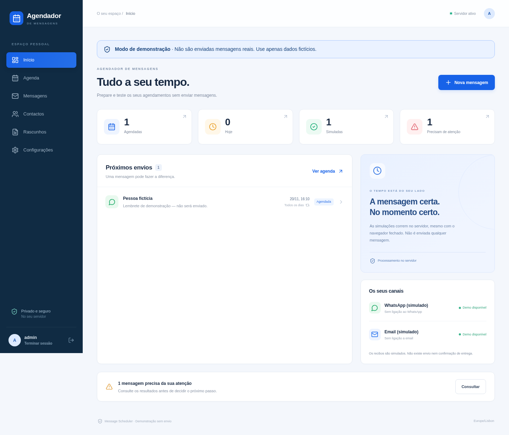

# Message Scheduler

A self-hosted message scheduling playground with a React interface, FastAPI backend and persistent SQLite queue.

**Version 0.1.0 is demo-only. It never sends WhatsApp messages or email.** Both channel labels are simulations. No real provider, account session, QR authentication or contact integration is included. Use fictional data only.

Independent community software; not an official product of, endorsed by, or affiliated with WhatsApp or Meta.

[Português de Portugal](README.pt-PT.md) · [Install](docs/INSTALLATION.md) · [Providers](docs/PROVIDERS.md) · [Security](docs/SECURITY-GUIDE.md) · [Backup and restore](docs/BACKUP-RESTORE.md)

## Quick start

Requirements: Docker Engine with Compose v2 and Python 3.10+ for the setup helper. No Node or Python packages are needed on the host to run the app. Run from a downloaded/extracted copy of this source directory:

```sh
python3 scripts/setup.py
docker compose up -d --build --wait
```

Open <http://localhost:8080>. Sign in as `admin` with the generated password stored in your local `.env` (read it privately). No shared/default password is shipped. Change it in Settings after first login; subsequent starts keep the saved hash. The app listens only on host loopback by default.

The intended repository name is `Coretrail/whatsapp-message-scheduler`. This release preparation does not assume that repository has been created.

## What works

- Authenticated administration, CSRF checks, login throttling and password changes.
- Create, preview, edit, duplicate, cancel and draft messages; desktop and mobile layouts.
- One-time, daily, selected weekdays, weekly, monthly and yearly scheduling in **Europe/Lisbon**.
- Persistent queue, worker heartbeat, atomic reservations and optimistic edit versions.
- Simulated receipts, history, rate limits and explicit per-message consent simulation.
- Bounded known-safe retries, uncertain-result quarantine and overdue confirmation.
- Consistent SQLite backups and quarantined recovery into a new file.

`accepted` is an internal scheduling state; in this version it means **simulation completed**, never a real send or delivery. Recurrence advances after a simulated acceptance. Unknown outcomes are never automatically retried. No exactly-once remote-delivery guarantee is claimed.

## Explicit limits

No Cloud API/Gmail/SMTP integration, real delivery, webhooks, shared opt-out registry, consent evidence verification, automatic backup encryption/rotation, multi-user roles, attachments, localisation switch, or offline PWA is implemented. UI is European Portuguese; documentation is bilingual at the entry point. Time zone is fixed to Europe/Lisbon. See [limitations and roadmap](docs/LIMITATIONS.md).



[Mobile screenshot](docs/images/mobile.png) · [Message editor](docs/images/compose-desktop.png)

## Development and checks

```sh
docker build --target test -t scheduler-tests .
docker run --rm --network none scheduler-tests
cd frontend
npm ci
npm run build
npx playwright install --with-deps chromium
# Target a fresh, isolated demo instance; enter its password without sharing it.
read -rs DEMO_PASSWORD; export DEMO_PASSWORD
npm run test:e2e
unset DEMO_PASSWORD
```

Tests use fictional fixtures. Browser smoke adds demo schedules/drafts to its target; never point it at another application. The reproducible Docker integration script is `tests/docker_smoke.py`; set `COMPOSE_PROJECT_NAME`, `DEMO_URL`, `DEMO_PASSWORD` and optionally `DEMO_ENV_FILE` for your fresh test project. It exercises worker, password change, restart and an actual isolated recovery switch. See [verification](docs/VERIFICATION.md) and [contribution guidelines](CONTRIBUTING.md).

MIT licensed project code; dependency licences remain applicable. See [LICENSE](LICENSE), [notices](THIRD_PARTY_NOTICES.md) and [provenance review](docs/DEPENDENCIES.md).
