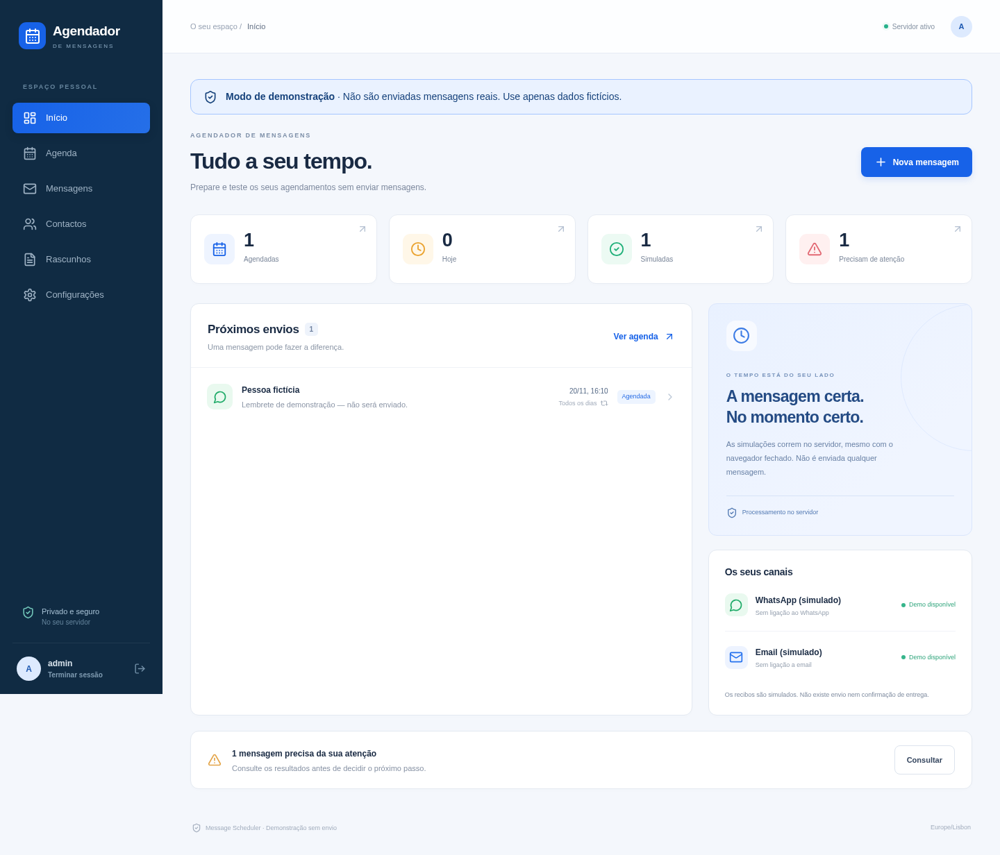

# Agendador de Mensagens

Aplicação alojada no seu servidor, com interface React, API FastAPI e fila persistente SQLite.

**A versão 0.1.0 funciona integralmente em demonstração. Não envia mensagens WhatsApp nem emails.** Os dois canais são simulados. Não inclui sessões de contas, autenticação por QR, contactos externos ou fornecedores de envio real. Utilize apenas dados fictícios.

Projeto comunitário independente, sem caráter oficial, aprovação ou afiliação com WhatsApp ou Meta.

[English](README.md) · [Instalação](docs/INSTALLATION.md) · [Fornecedores](docs/PROVIDERS.md) · [Segurança](docs/SECURITY-GUIDE.md) · [Backup e recuperação](docs/BACKUP-RESTORE.md)

## Instalação rápida

Requisitos: Docker Engine com Compose v2 e Python 3.10+ para gerar a configuração. A aplicação não requer Node nem pacotes Python instalados no servidor. Na pasta obtida por transferência e extração do código:

```sh
python3 scripts/setup.py
docker compose up -d --build --wait
```

Abra <http://localhost:8080>. Entre com o utilizador `admin` e a palavra-passe gerada no ficheiro local `.env`, que deve consultar em privado. Altere a palavra-passe nas Configurações. Os arranques seguintes mantêm o hash guardado; editar a palavra-passe inicial no `.env` não redefine a conta.

Por predefinição, apenas o próprio servidor consegue aceder à porta. Para aceder remotamente, utilize um túnel SSH ou configure um proxy HTTPS conforme o guia. Nunca publique o `.env`.

## Funcionalidades disponíveis

- Administração autenticada, proteção CSRF, limitação de tentativas de login e alteração de palavra-passe.
- Criação, edição, pré-visualização, duplicação, cancelamento e rascunhos.
- Agenda por data/hora; recorrências diárias, semanais, mensais, anuais e por dias escolhidos.
- Fila persistente, reservas atómicas, controlo de versões, worker e histórico operacional.
- Limite de tentativas por hora e confirmação de consentimento por mensagem, para fins de simulação.
- Tentativas limitadas quando se sabe que não houve submissão; resultados incertos e atrasos exigem revisão.
- Backup consistente e recuperação em ficheiro novo, com agendamentos em quarentena.
- Interface responsiva para computador e telemóvel.

O estado interno `accepted` corresponde a uma **simulação concluída**, nunca a envio ou entrega real. O fuso é fixo: **Europe/Lisbon**. Horas inexistentes na mudança de hora são ignoradas nas recorrências; horas repetidas são processadas uma única vez.

## Limitações desta versão

A Cloud API oficial está apenas documentada como integração futura. Não existem fornecedores reais WhatsApp, Gmail ou SMTP, webhooks de entrega, registo global de recusas, verificação de prova de consentimento, encriptação/rotação automática de backups, vários administradores, anexos, escolha de idioma ou PWA offline. A interface está em português de Portugal. Consulte [limitações](docs/LIMITATIONS.md).



[Captura mobile](docs/images/mobile.png) · [Editor de mensagens](docs/images/compose-desktop.png)

## Testes e contribuição

```sh
docker build --target test -t scheduler-tests .
docker run --rm --network none scheduler-tests
```

Os testes de navegador, descritos no README inglês, devem usar uma instalação de demonstração isolada: criam rascunhos e agendamentos fictícios. Consulte [CONTRIBUTING.md](CONTRIBUTING.md), [SECURITY.md](SECURITY.md) e o [relatório de verificação](docs/VERIFICATION.md).

Código do projeto sob licença MIT. As dependências mantêm as suas próprias licenças; ver [avisos](THIRD_PARTY_NOTICES.md). A preparação local não cria nem publica o repositório GitHub previsto.
